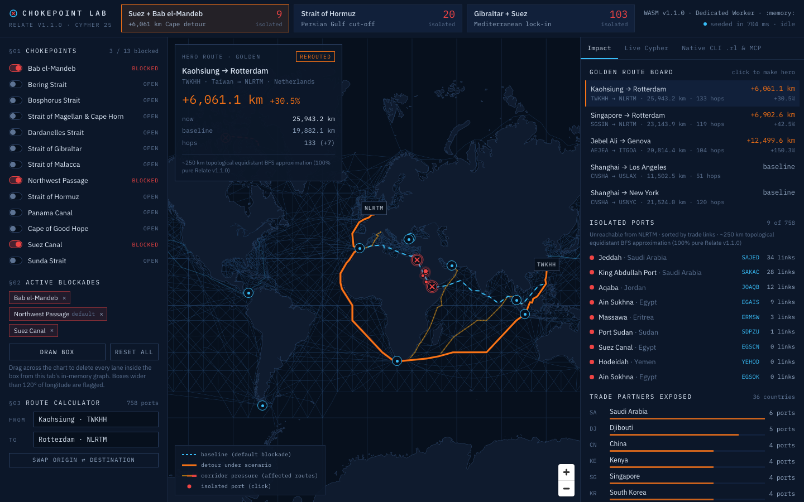
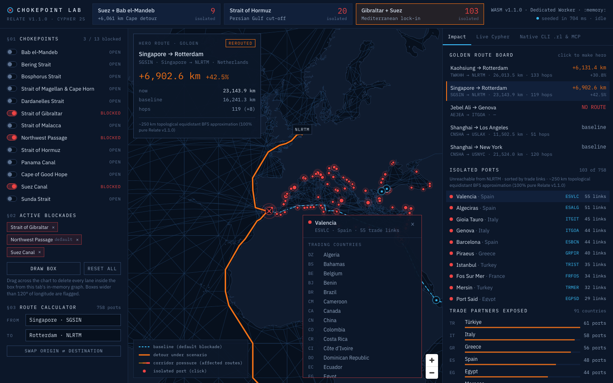
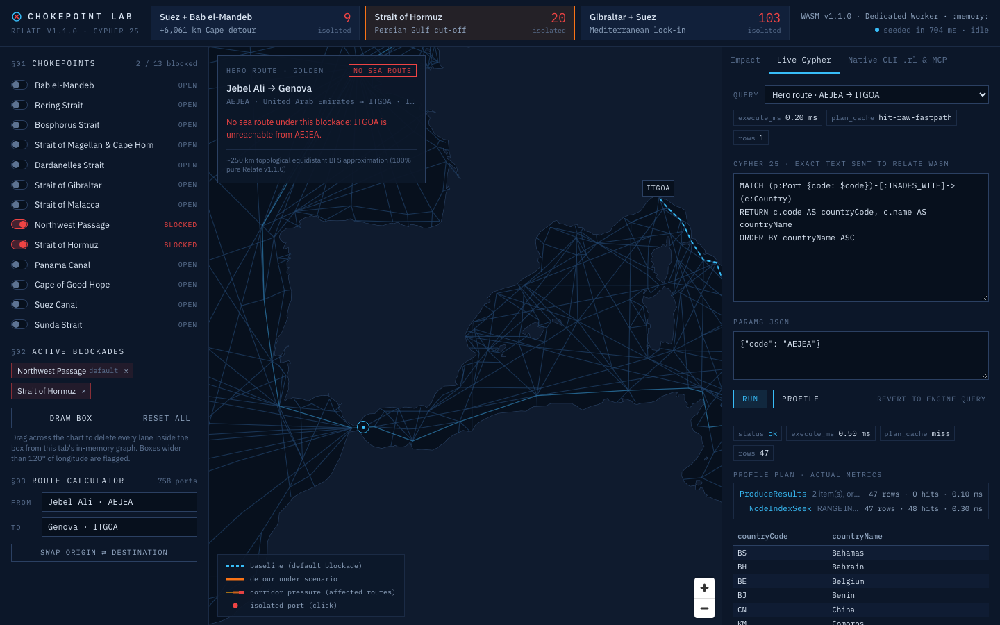
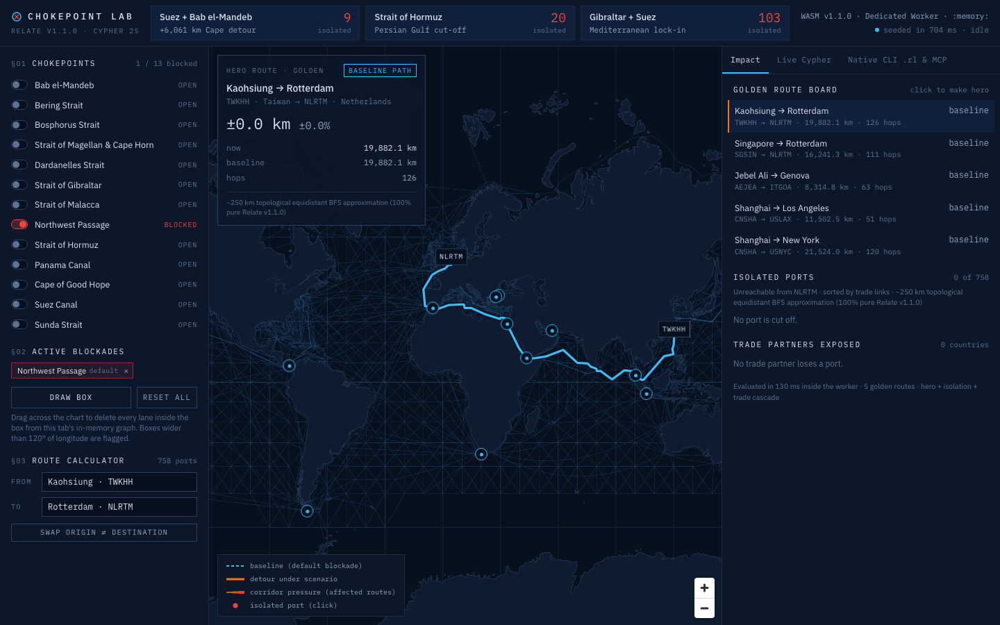

# Chokepoint Lab — Devpost Submission

**Tagline (≤60 chars):** Global maritime chokepoint simulator powered 100% by Relate

**Live Workbench (zero install, zero server):** https://relate-chokepoint-lab.vercel.app  
**Public Repository (topic: `relate`, `relate-neo4j-hackathon`):** https://github.com/GGGODLIN/relate-chokepoint-lab  
**Persistent Relate Store (non-LFS single file):** https://github.com/GGGODLIN/relate-chokepoint-lab/blob/main/data/chokepoint.rl  
**Demo Video (59.5 s):** https://youtu.be/2VzyKLDZK9A

---

## Inspiration

When the Suez Canal and Bab el-Mandeb come under disruption—or when analysts stress-test a simultaneous closure of the Strait of Hormuz or Strait of Gibraltar—supply chain planners need three answers immediately:

1. **Which major shipping routes are forced onto multi-thousand-kilometer detours?**
2. **Which commercial sea terminals lose every maritime escape route and become completely isolated?**
3. **Which trading partner countries are exposed downstream through those cut-off ports?**

With 13 strategic chokepoints, there are $2^{13} = 8,192$ closure combinations before even adding ad-hoc regional blockade zones. Static lookup tables cannot precompute arbitrary combinations, vector/text RAG cannot compute graph connectivity, and recursive SQL CTEs become slow and brittle on a 10,560-waypoint global maritime mesh. This is fundamentally a **connected graph reachability and multi-hop cascade problem**—exactly what **Relate `v1.1.0`** was built for.



---

## What it does

**Chokepoint Lab** runs the exact same canonical global maritime graph on **100% pure Relate `v1.1.0` (Cypher 25)** across three synchronized interfaces—with **zero backend server**, **zero API keys**, and **bit-for-bit Native ↔ WASM parity (`diffCount: 0`)**:

- **Zero-Install Browser Workbench (`@relate/relate-wasm@1.1.0`)**: Boots Relate WASM inside a Dedicated Web Worker in disposable `:memory:` mode (zero OPFS `storage locked` conflicts across multiple tabs or private windows) and renders an offline-capable MapLibre cartographic workbench (zero third-party tile requests).
- **3 One-Click Verified Scenarios + 13 Individual Chokepoint Toggles**:
  - **Suez + Bab el-Mandeb**: Isolates **9** Red Sea commercial terminals from Rotterdam (`NLRTM`) and forces Kaohsiung → Rotterdam (`TWKHH → NLRTM`) around the Cape of Good Hope (`19,882.1 km → 25,943.2 km`, **+6,061.1 km / +30.5%**), with Tier 2 corridor pressure highlighting shared Cape detour lanes.
  - **Strait of Hormuz**: Isolates **20** Persian Gulf terminals (led by Jebel Ali `AEJEA`, Abu Dhabi `AEAUH`, Hamad `QAHMD`) and ranks exposed trading partner countries via `(:Port)-[:TRADES_WITH]->(:Country)` (`AE`: 11 ports, `IN`: 8, `PK`: 7, `BH`: 6, `SG`: 6).
  - **Gibraltar + Suez**: Seals both Mediterranean gateways, isolating **103** Mediterranean and Black Sea terminals. Click any isolated port (e.g., Valencia `ESVLC` with 55 trade links) to fly directly to it and inspect its exposed partner countries.
- **Custom Spatial Blockade Box (`point.withinBBox()` + `POINT INDEX`)**: Draw an arbitrary blockade rectangle anywhere on Earth—including across the International Date Line (`±180°`) and regardless of drag direction—to sever matching sea lanes in-memory and recompute detours and isolation live.
- **Editable Live Cypher 25 Inspector & `PROFILE`**: View the exact Cypher 25 statement and JSON parameters sent to Relate WASM, edit and run any query across all 758 commercial terminals, inspect real wire telemetry (`execute_ms`, `plan_cache`, `PROFILE` operator metrics), and recover cleanly from syntax errors or graph writes.
- **Native Single-File Store (`data/chokepoint.rl`) + Built-In MCP Server**: Ships a 2.8 MB non-LFS persistent `.rl` bundle (SHA-256 verified) with one-command read-only CLI queries, a self-verifying 3-stage `.begin` → `DELETE` → `shortestPath` → `.rollback` script on an isolated `relate clone`, and Relate's built-in MCP server (`relate serve --database :memory: --load data/chokepoint.rl --mcp 7475`).



---

## How we built it

### 1. Single Canonical Maritime Graph Model
From pinned Apache-2.0 `searoute-py` shipping lanes (`marnet_searoute.geojson`) and port records (`ports.geojson`), our deterministic ETL (`src/etl/build-graph.ts`) preserves all 1,337 T-junctions, stitches the antimeridian (`±180°` and `lon > 180`), patches the untagged Cape of Good Hope parallel bypass edges, resamples corridors at `~250 km` intervals so Relate's unweighted bidirectional BFS approximates real maritime distances (explicitly labeled as topological equidistant approximation), and filters to **758 Tier-1 commercial sea terminals** (`t == 1.0 && snap <= 100 km`, zero duplicates, zero inland cities).

- **Nodes (`11,493`)**: `10,560` `:WP` waypoints · `758` `:Port` terminals · `175` `:Country` partners (`connected_components: 1`)
- **Relationships (`23,986`)**: `17,475` `:SEA_OPEN` (`16,717` open-sea lanes + `758` port links) · `84` `:PASSAGE_*` across 13 distinct chokepoint relationship types · `6,427` `(:Port)-[:TRADES_WITH]->(:Country)` edges
- **Indexes (`5` online)**: `:Port(code)`, `:WP(id)`, `:Country(code)`, and spatial `POINT INDEX` on `:Port(loc)` and `:WP(loc)`

### 2. Why Relate `v1.1.0` Static Relationship-Type Disjunctions Matter
Empirical benchmarking on Relate `v1.1.0` revealed that placing edge-property `WHERE` predicates inside variable-length `shortestPath` degrades traversal into unpruned DFS. By encoding open ocean (`:SEA_OPEN`) and each of the 13 chokepoints (`:PASSAGE_SUEZ`, `:PASSAGE_ORMUZ`, etc.) as **14 static relationship types**, every blockade scenario compiles into a single-colon Cypher 25 static disjunction:

```cypher
MATCH (a:Port {code: $from}), (b:Port {code: $to})
OPTIONAL MATCH p = shortestPath(
  (a)-[:SEA_OPEN|PASSAGE_BERING|PASSAGE_BOSPORUS|PASSAGE_CHILI|PASSAGE_DARDANELLES|PASSAGE_GIBRALTAR|PASSAGE_MALACCA|PASSAGE_ORMUZ|PASSAGE_PANAMA|PASSAGE_SOUTH_AFRICA|PASSAGE_SUNDA*]-(b)
)
WHERE a <> b
RETURN length(p) AS hops, round(reduce(km = 0.0, r IN relationships(p) | km + r.km), 1) AS totalKm
```

This keeps every route query on Relate's fast $O(V+E)$ bidirectional BFS path (`0.20–15 ms` per O-D pair, `67–230 ms` for full 1-to-ALL 758-port isolation and trade-partner aggregation) with zero external JS routing fallbacks.

### 3. Single-Source Dual-Surface Projection & Verification
One canonical graph projects unidirectionally to:
1. `data/chokepoint.rl` (2.8 MB regular git file, SHA-256 `776fa235cacefa6f551cbb4925fa640342d1814db9b993e9175f7aa50866c282`)
2. Content-hashed `dist/assets/graph.wasm-<hash>.json` (`Cache-Control: public, max-age=31536000, immutable` on Vercel alongside `application/wasm`)
3. `public/data/marnet.map.geojson` + offline Public Domain Natural Earth 1:50m `public/data/land.geojson`



---

## Challenges we ran into

- **Relate `v1.1.0` Cypher 25 & CLI syntax subtleties**: Early gate probes caught that Relate `v1.1.0` requires single leading colons in variable-length type unions (`[:SEA_OPEN|PASSAGE_PANAMA*]`, rejecting `|:PASSAGE_`), hangs if `NULL` endpoints enter `OPTIONAL MATCH shortestPath` (solved via `WHERE a <> b` + same-waypoint short-circuit), and requires `--database :memory:` alongside `--load` when launching `relate serve --mcp`.
- **Golden `.rl` immutability**: Opening a `.rl` store in native CLI runs `final_checkpoint` on exit, which mutates its SHA-256 even after `.rollback`. Our rollback verification (`npm run verify:rollback`) solves this by executing the 3-stage `.begin` → `DELETE` → `.rollback` script against an isolated `relate clone` copy, keeping the repo's golden `data/chokepoint.rl` byte-identical.
- **Browser reliability & concurrency**: Eliminated OPFS cross-tab `storage locked` traps by running Relate WASM purely in `:memory:` inside a Dedicated Worker; hardened Worker timeout/trap respawn generation tracking, preset-vs-drag-box race conditions, and antimeridian `±180°` drag-box splitting via 625 randomized `fast-check` concurrency patrols and 86 automated tests.

---

## Accomplishments that we're proud of

- **100% Pure Relate Single Engine**: Zero `searoute-ts`, zero JS graph fallback, zero backend APIs, zero third-party map tiles—every route, isolation count, spatial box cut, and trade cascade executes live in Relate `v1.1.0`.
- **Bit-for-Bit Parity (`diffCount: 0`)**: `npm run verify:parity` proves identical node/edge counts, all 20 golden-route evaluations, all 3 preset isolation port lists (`9 / 20 / 103`), and Hormuz trade-partner rankings between native `data/chokepoint.rl` and `@relate/relate-wasm@1.1.0`.
- **Verified Built-In MCP Integration**: `relate serve --database :memory: --load data/chokepoint.rl --mcp 7475` exposes read-only `read_cypher` and `get_schema` tools over Streamable HTTP without locking or modifying `data/chokepoint.rl` (tested end-to-end returning `25,943.2 km` in `5.08 ms` and Hormuz top-5 exposed countries in `67.18 ms`).
- **20/20 Live Production Browser Checks**: Verified directly against `https://relate-chokepoint-lab.vercel.app` with dual concurrent browser tabs, zero OPFS errors, zero console errors, and zero external network requests.



---

## What we learned

- Modeling domain constraints directly into **static relationship types** turns what would otherwise be an exponential filtered path search into sub-15 ms bidirectional BFS in Relate.
- Running a single embedded graph engine identically in both native binary (`.rl` + MCP) and browser WASM (`:memory:` Worker) eliminates the classic "demo web app vs. real database" drift.

---

## What's next for Chokepoint Lab

- Incorporating weighted vessel-draft constraints (Suezmax / Panamax / VLCC) and maritime freight cost / transit-day multipliers on top of the topological graph.
- Adding time-series disruption replay (comparing historical Red Sea 2024 rerouting volumes against real-time AIS corridor density).

---

## Built With

- `relate` (`v1.1.0` native CLI & built-in MCP server)
- `@relate/relate-wasm` (`1.1.0`)
- `cypher` (Cypher 25)
- `typescript`
- `react` (React 19)
- `maplibre-gl`
- `tailwindcss` (v4)
- `vite`
- `vitest`
- `fast-check`
- `vercel`

---

## Datasets, Attribution & AI Disclosure

- **Maritime Lanes & Ports**: Pinned snapshots from `searoute-py` (Eurostat / Marnet, Apache License 2.0, see [NOTICE](https://github.com/GGGODLIN/relate-chokepoint-lab/blob/main/NOTICE)).
- **Offline Land Basemap**: Simplified from Natural Earth 1:50m Physical Vectors Land Polygons (Public Domain, https://www.naturalearthdata.com/about/terms-of-use/).
- **Approximation Scope**: Route distances are topological equidistant BFS approximations (`~250 km` corridor resampling) executed purely inside Relate `v1.1.0`, not navigational nautical-mile charts.
- **AI Assistance Disclosure**: AI coding agents (Claude Code) assisted with ETL scaffolding, TypeScript/React implementation, property-based testing, and documentation review. Every Relate query, parity check, rollback proof, MCP call, and live browser test was executed and verified directly against real Relate `v1.1.0` binaries and `@relate/relate-wasm@1.1.0`.
